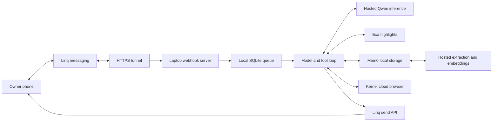

# Personal agent architecture

The workshop keeps the AIE presentation’s model and tool loop, Exa retrieval, and Mem0 context. Linq connects a real phone to the local application. Kernel replaces Browser Use for the rendered-page tool.

Every tool result returns to the model. Search can answer from highlights; Kernel reads a page when a specific fact is missing or the owner explicitly asks. Persistent memory contains explicitly saved personal facts. Chat history retains at most 20 recent messages per owner.

| Component | Files | Runs where |
| --- | --- | --- |
| Entry points and configuration | `src/cli.ts`, `src/server.ts`, `src/config.ts` | Laptop |
| Model and tool loop | `src/agent.ts`, `src/model.ts` | Laptop orchestration, hosted inference |
| Exa retrieval | `search()` in `src/agent.ts` | Hosted search, compact results on laptop |
| Persistent memory | `src/memory.ts`, `src/memory-worker.ts` | Local Mem0 files, hosted extraction/embeddings |
| Message validation and queue | `src/http.ts`, `src/linq.ts`, `src/store.ts`, `src/worker.ts` | Laptop |
| Phone transport | Linq API and webhook subscription | Hosted |
| Rendered-page integration | `src/browser.ts` | Local adapter, Kernel cloud browser |

## Kernel page inspection

Milestone 3 enables the browser tool when `KERNEL_API_KEY` is configured. The adapter uses `@onkernel/sdk` to create a session, execute fixed read-only Playwright code, and delete the session. No local Chromium, Playwright package, Python worker, or Browser Use dependency is needed.

The tool reads page title, URL, and bounded visible body text. The model receives the text and the question it was trying to answer. This is rendered-page inspection, not a general agent that clicks through sites. Only a named HTTPS target from this turn’s search or user message is accepted. Session egress is restricted to the requested hostname; cross-host redirects and resources may be blocked. User and model text never become executable Playwright code. Browser deletion uses a separate timeout so cancellation does not skip cleanup; the session also has a 60-second inactivity timeout.

[Kernel’s SDK quickstart](https://www.kernel.sh/docs/start/quickstart) documents the create → execute → delete lifecycle. The SDK version is pinned in the Node lockfile.

## Messaging and memory boundaries

Signature validation checks the raw webhook body and a five-minute timestamp window. Event and message identifiers deduplicate incoming jobs. Only the configured owner’s direct messages on the configured line reach the agent. The queue acknowledges promptly, processes in order, retries failures, and reuses a stable outbound idempotency key.

The model has a bounded tool loop, at most eight tool calls and one browser task per reply. From milestone 4, memory tools handle explicit requests to remember, list, or forget preferences; help and conversation reset are also tools. Automatic recall remains application-managed. Slash commands are optional shortcuts. The application avoids logging provider payloads or phone numbers. Run one server per data directory; this is a single-owner teaching application.

There is no scheduler, proactive alert engine, calendar integration, booking flow, or purchase tool. Clearing local memory cannot erase records already sent through hosted providers. API costs depend on provider choices and usage.

## References

[Exa search](https://exa.ai/docs/reference/search) · [Mem0 OSS](https://github.com/mem0ai/mem0) · [Kernel SDK](https://github.com/kernel/kernel-typescript-sdk) · [Qwen endpoint](https://openrouter.ai/qwen/qwen3.8-27b) · [Linq V3](https://docs.linqapp.com/channel/imessage/api/)

## Starter and complete version

`starter/integrations.ts` has five unfinished provider callbacks. `starter/agent.ts` injects them explicitly into the supplied bounded loop. Terminal and phone entry points are `starter/cli.ts` and `starter/server.ts`. Shared schemas, provider adapters, storage, and webhook verification are infrastructure rather than exercise gaps.

The complete version lives in `src/`. `solution:chat` and `solution:phone` never import the starter, so unfinished exercises cannot break the instructor demo. `starter:chat` and `starter:phone` never substitute completed provider callbacks for TODOs.

